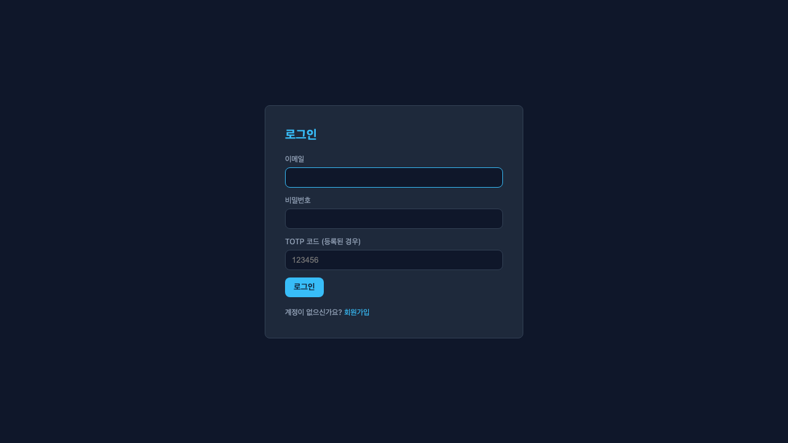
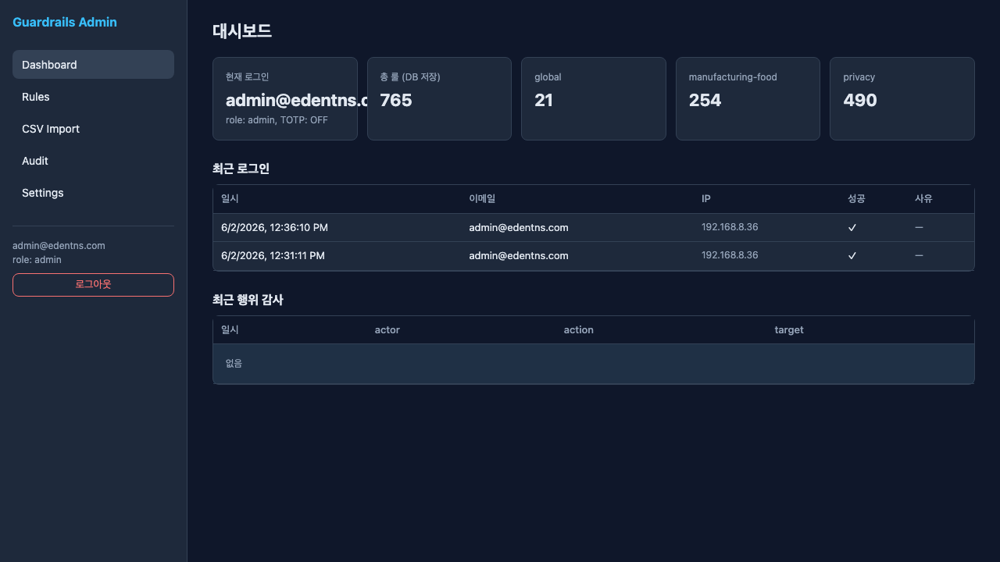
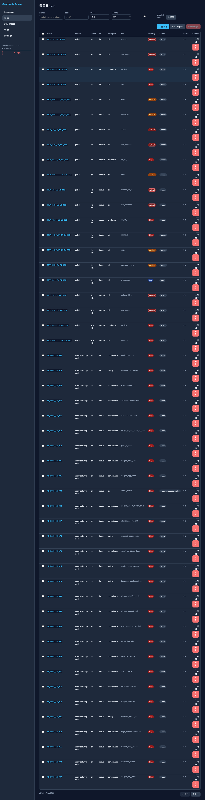
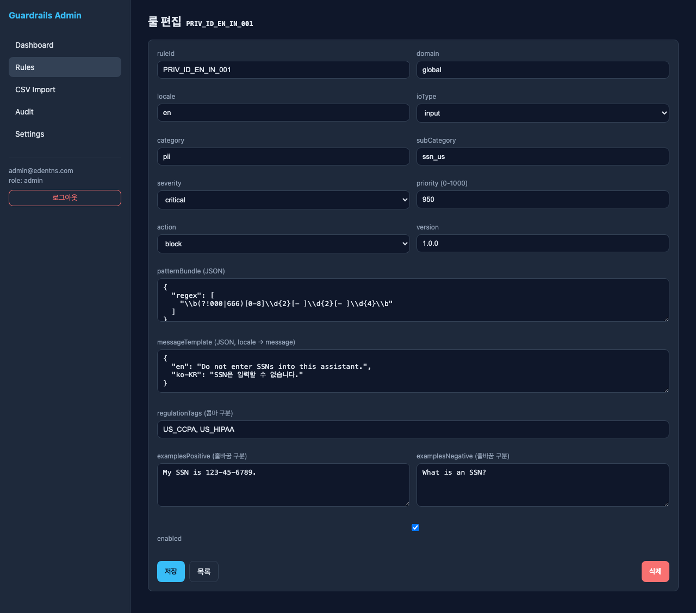
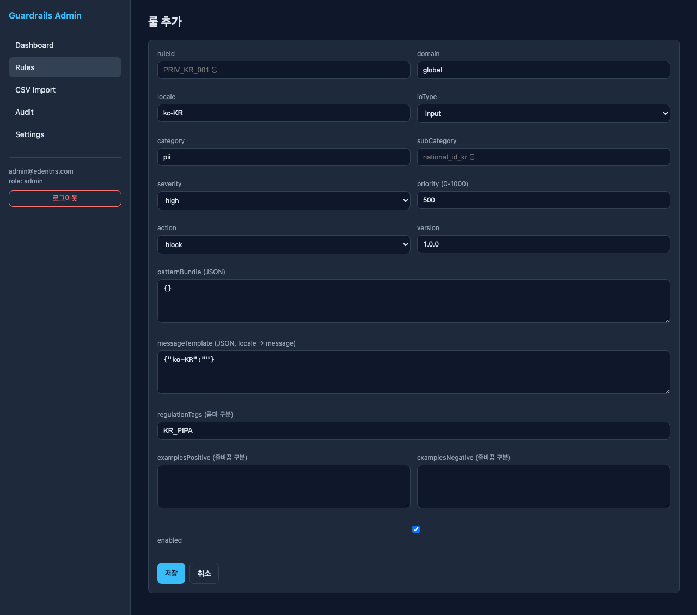
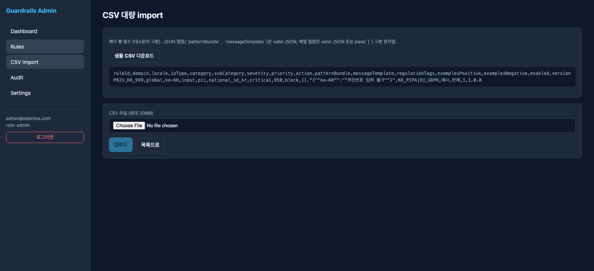
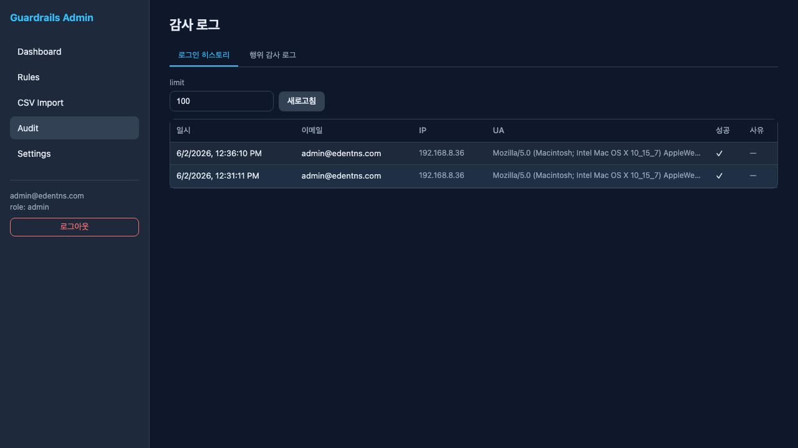
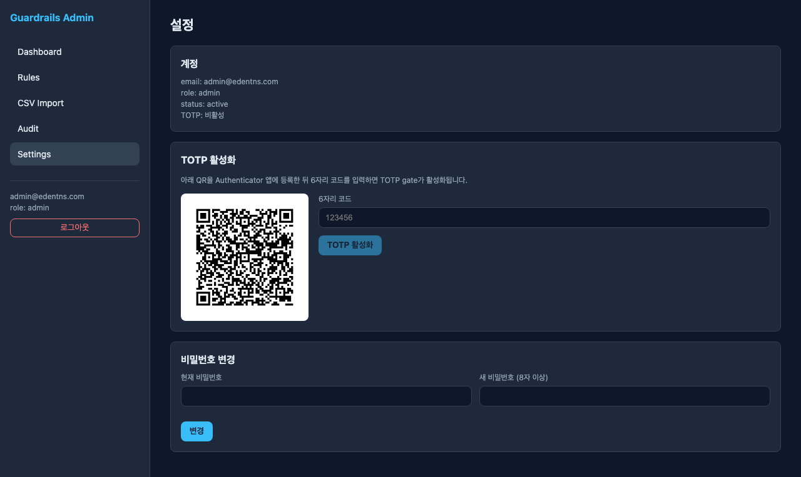

# DocuGuard-AI (Guardrails Admin) Feature Analysis

- **Target URL**: http://192.168.8.243:3001/
- **Analyzed**: 2026-06-02
- **Account**: admin@edentns.com (role: admin)
- **Product**: Guardrails Admin — management console for LLM input/output guardrail rules
- **Screenshots**: [`Analysis-DocuGuard-AI/`](Analysis-DocuGuard-AI/)

A back-office web app for managing guardrail rules (PII / compliance / safety, etc.) stored in a database. Two-column layout: fixed left nav (Dashboard / Rules / CSV Import / Audit / Settings) + right content area, dark theme.

---

## 1. Login

- Route: `/login`
- Inputs: **email**, **password**, **TOTP code (if registered)**
- Buttons: Login / Sign-up link
- Redirects to `/dashboard` on success. TOTP is optional 2FA (skipped when not registered).

## 2. Dashboard

- Route: `/dashboard`
- **5 KPI cards**:
  - Current logged-in account (email, role, TOTP status)
  - Total rules (DB-stored): **765**
  - Per-domain breakdown: `global` 21 / `manufacturing-food` 254 / `privacy` 490
- **Recent logins** table: timestamp / email / IP / success / reason
- **Recent action audit** table: timestamp / actor / action / target (currently empty)

## 3. Rules List

- Route: `/rules` — **765 rules total**
- **Filters**: domain, locale, ioType (input/output/both), category (pii/compliance/ip/safety/financial/health/credentials/location/sensitive/children/biometrics/fraud/prompt_injection/scope/hallucination), scope, `enabled only` checkbox
- **Action buttons**: Refresh / + Add Rule / CSV import / Bulk delete (multi-select checkboxes)
- **Table columns**: ruleId, domain, locale, io, category, sub, severity, action, source, [Edit/Delete]
- **Pagination**: offset / total based, Prev / Next
- severity shown as colored badge (critical/high/medium/low); action also badged (block/redact/warn, etc.)

## 4. Rule Editor (Edit / Add)

- Route: `/rules/{ruleId}` (edit), `/rules/new` (add)
- **Fields**:
  - ruleId, domain, locale, ioType (input/output/both)
  - category, subCategory
  - severity (low/medium/high/critical), priority (0–1000)
  - action (allow/warn/redact/sanitize/block/block_or_redact/block_or_pseudonymize/aggregate_only/refuse/escalate/add_disclaimer/route)
  - version
  - **patternBundle (JSON)** — detection patterns such as a regex array
  - **messageTemplate (JSON, locale→message)** — localized block messages
  - regulationTags (comma-separated, e.g. US_CCPA, US_HIPAA)
  - examplesPositive / examplesNegative (newline-separated)
  - enabled toggle
- Buttons: Save / List / Delete

- Add screen uses the same form with empty defaults (`patternBundle: {}`, `messageTemplate: {"ko-KR":""}`). Buttons: Save / Cancel

## 5. CSV Bulk Import

- Route: `/rules/import`
- **Format rules**: header row required (case-sensitive). JSON columns (`patternBundle`, `messageTemplate`) must be valid JSON; array columns are valid JSON or pipe(`|`)-separated strings.
- Provides a **sample CSV download** + inline example
- Header: `ruleId,domain,locale,ioType,category,subCategory,severity,priority,action,patternBundle,messageTemplate,regulationTags,examplesPositive,examplesNegative,enabled,version`
- File upload (max **20MB**) → Upload / Back to list

## 6. Audit Log

- Route: `/audit` — **2 tabs**
  - **Login history**: timestamp / email / IP / UA / success / reason
  - **Action audit log**: change tracking by actor / action / target
- `limit` input + Refresh to control row count

## 7. Settings

- Route: `/settings`
- **Account**: email / role / status / TOTP status
- **Enable TOTP**: show QR → register in authenticator app → enter 6-digit code → enable
- **Change password**: current password + new password (8+ chars) → submit

---

## Summary

| # | Feature | Route | Core |
|---|---------|-------|------|
| 1 | Login | `/login` | email/password + optional TOTP |
| 2 | Dashboard | `/dashboard` | rule KPIs, recent logins/audit |
| 3 | Rules list | `/rules` | 765 rules, multi-filter, CRUD, bulk delete |
| 4 | Rule editor | `/rules/{id}`, `/rules/new` | JSON form for pattern/message/action/reg-tags |
| 5 | CSV Import | `/rules/import` | header validation, 20MB, sample provided |
| 6 | Audit log | `/audit` | login history + action audit |
| 7 | Settings | `/settings` | TOTP (QR), password change |

**Nature**: a back-office for ops teams to directly manage, version, and ship AI guardrail rulesets (input/output filtering) from a database. Designed around domains (global/manufacturing-food/privacy), locales (en/ko-KR), and regulation tags (CCPA/HIPAA/GDPR/PIPA).
