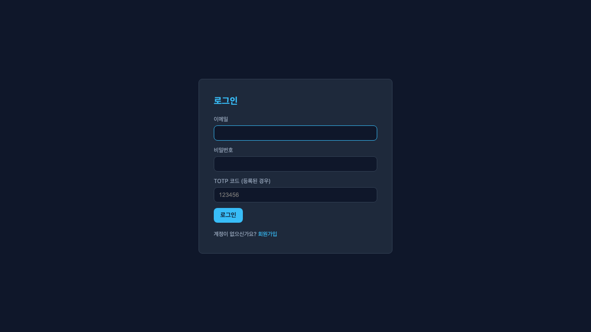
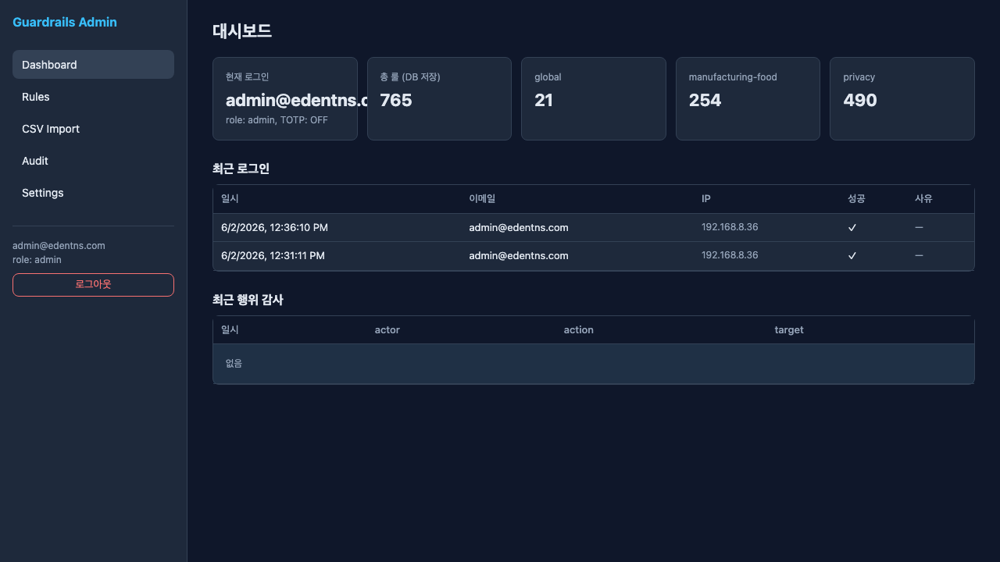
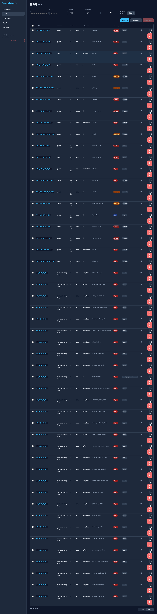
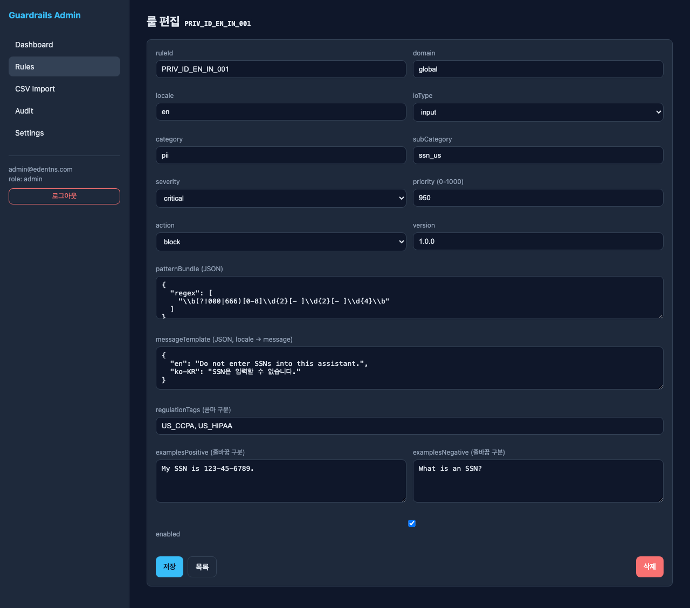
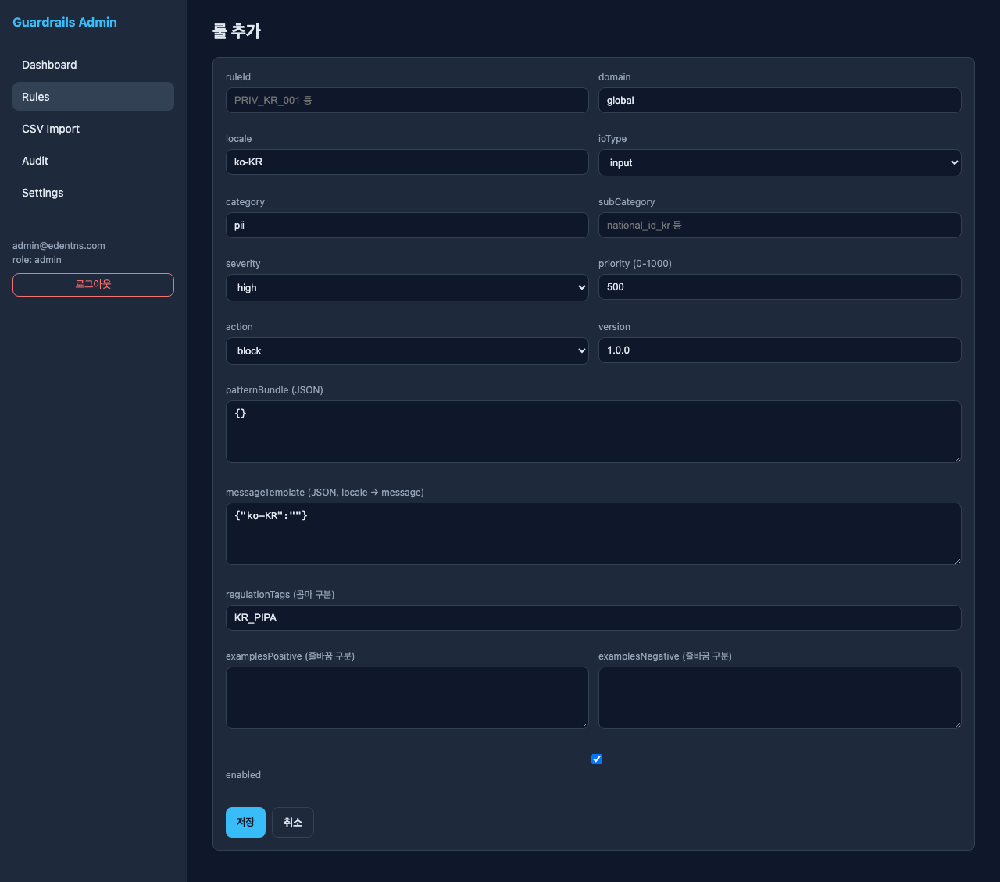
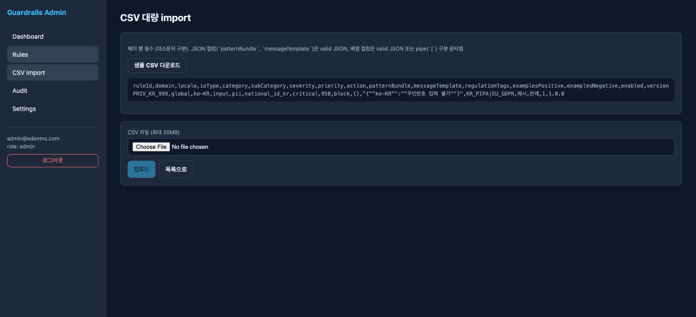
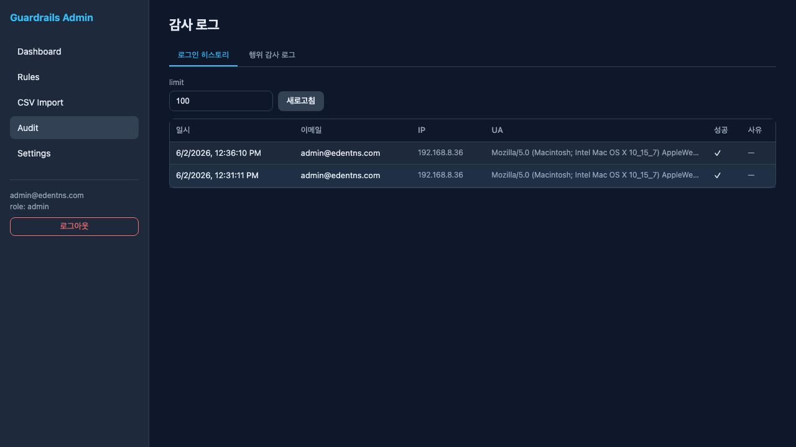
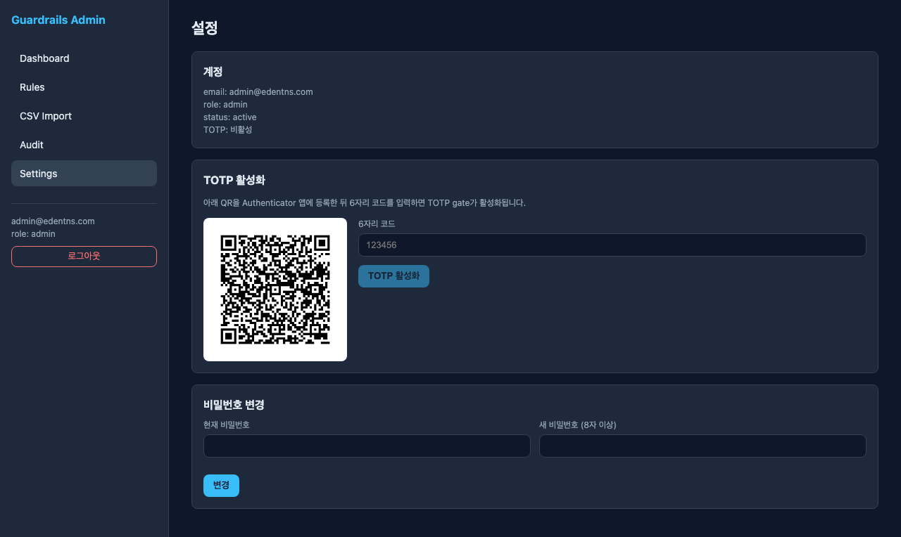

# DocuGuard-AI (Guardrails Admin) 기능 분석

- **대상 URL**: http://192.168.8.243:3001/
- **분석일**: 2026-06-02
- **계정**: admin@edentns.com (role: admin)
- **제품명**: Guardrails Admin — LLM 입출력 가드레일 룰 관리 콘솔
- **캡쳐 위치**: [`Analysis-DocuGuard-AI/`](Analysis-DocuGuard-AI/)

가드레일 룰(PII/컴플라이언스/안전 등)을 DB 기반으로 관리하는 어드민 웹. 좌측 고정 네비게이션(Dashboard / Rules / CSV Import / Audit / Settings) + 우측 콘텐츠 2단 레이아웃, 다크 테마.

---

## 1. 로그인 (Login)

- 경로: `/login`
- 입력: **이메일**, **비밀번호**, **TOTP 코드(등록된 경우)**
- 버튼: 로그인 / 회원가입 링크
- 인증 성공 시 `/dashboard` 리디렉션. TOTP는 선택적 2단계 인증(미등록 시 생략).

## 2. 대시보드 (Dashboard)

- 경로: `/dashboard`
- **KPI 카드 5종**:
  - 현재 로그인 계정 (email, role, TOTP 상태)
  - 총 룰(DB 저장): **765**
  - 도메인별 분포: `global` 21 / `manufacturing-food` 254 / `privacy` 490
- **최근 로그인** 테이블: 일시 / 이메일 / IP / 성공 / 사유
- **최근 행위 감사** 테이블: 일시 / actor / action / target (현재 데이터 없음 = "없음")

## 3. 룰 목록 (Rules)

- 경로: `/rules` — 총 **765건**
- **필터**: domain, locale, ioType(input/output/both), category(pii/compliance/ip/safety/financial/health/credentials/location/sensitive/children/biometrics/fraud/prompt_injection/scope/hallucination), scope, `enabled only` 체크박스
- **액션 버튼**: 새로고침 / + 룰 추가 / CSV import / 선택 삭제(체크박스 다중 선택)
- **테이블 컬럼**: ruleId, domain, locale, io, category, sub, severity, action, source, [편집/삭제]
- **페이지네이션**: offset / total 기반, ← 이전 / 다음 →
- severity는 색상 뱃지(critical/high/medium/low), action도 뱃지(block/redact/warn 등)로 표기.

## 4. 룰 편집 / 추가 (Rule Editor)

- 경로: `/rules/{ruleId}` (편집), `/rules/new` (추가)
- **필드**:
  - ruleId, domain, locale, ioType(input/output/both)
  - category, subCategory
  - severity(low/medium/high/critical), priority(0–1000)
  - action(allow/warn/redact/sanitize/block/block_or_redact/block_or_pseudonymize/aggregate_only/refuse/escalate/add_disclaimer/route)
  - version
  - **patternBundle (JSON)** — regex 배열 등 탐지 패턴
  - **messageTemplate (JSON, locale→message)** — 다국어 차단 메시지
  - regulationTags (콤마 구분, 예: US_CCPA, US_HIPAA)
  - examplesPositive / examplesNegative (줄바꿈 구분)
  - enabled 토글
- 버튼: 저장 / 목록 / 삭제

- 추가 화면은 동일 폼에 빈 기본값(`patternBundle: {}`, `messageTemplate: {"ko-KR":""}`). 버튼: 저장 / 취소

## 5. CSV 대량 Import

- 경로: `/rules/import`
- **포맷 규칙**: 헤더 행 필수(대소문자 구분). JSON 컬럼(`patternBundle`, `messageTemplate`)은 valid JSON, 배열 컬럼은 valid JSON 또는 pipe(`|`) 구분 문자열.
- **샘플 CSV 다운로드** 제공 + 인라인 예시 표시
- 헤더: `ruleId,domain,locale,ioType,category,subCategory,severity,priority,action,patternBundle,messageTemplate,regulationTags,examplesPositive,examplesNegative,enabled,version`
- 파일 업로드 (최대 **20MB**) → 업로드 / 목록으로

## 6. 감사 로그 (Audit)

- 경로: `/audit` — **2개 탭**
  - **로그인 히스토리**: 일시 / 이메일 / IP / UA / 성공 / 사유
  - **행위 감사 로그**: actor / action / target 기반 변경 추적
- `limit` 입력 + 새로고침으로 조회 건수 제어

## 7. 설정 (Settings)

- 경로: `/settings`
- **계정**: email / role / status / TOTP 상태 표시
- **TOTP 활성화**: QR 코드 표시 → Authenticator 앱 등록 → 6자리 코드 입력 → 활성화
- **비밀번호 변경**: 현재 비밀번호 + 새 비밀번호(8자 이상) → 변경

---

## 요약

| # | 기능 | 경로 | 핵심 |
|---|------|------|------|
| 1 | 로그인 | `/login` | 이메일/비번 + 선택적 TOTP |
| 2 | 대시보드 | `/dashboard` | 룰 KPI, 최근 로그인/감사 |
| 3 | 룰 목록 | `/rules` | 765건, 다중 필터, CRUD, 대량삭제 |
| 4 | 룰 편집/추가 | `/rules/{id}`, `/rules/new` | 패턴/메시지/액션/정규태그 JSON 폼 |
| 5 | CSV Import | `/rules/import` | 헤더 검증, 20MB, 샘플 제공 |
| 6 | 감사 로그 | `/audit` | 로그인 히스토리 + 행위 감사 |
| 7 | 설정 | `/settings` | TOTP(QR), 비밀번호 변경 |

**성격**: AI 가드레일(입력·출력 검열) 룰셋을 운영팀이 DB에서 직접 관리·버전·배포하기 위한 백오피스. 도메인(global/manufacturing-food/privacy), 다국어(en/ko-KR), 규제태그(CCPA/HIPAA/GDPR/PIPA) 중심으로 설계됨.
