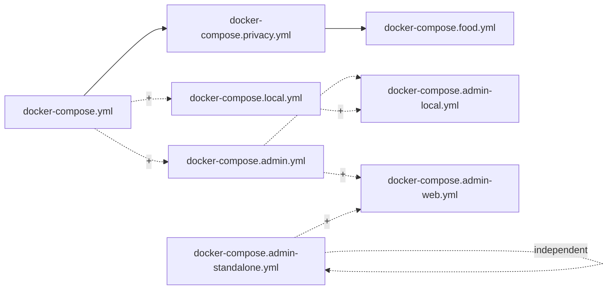
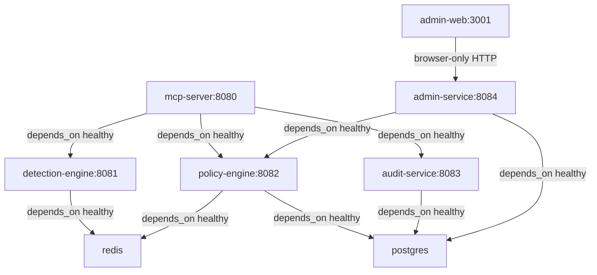
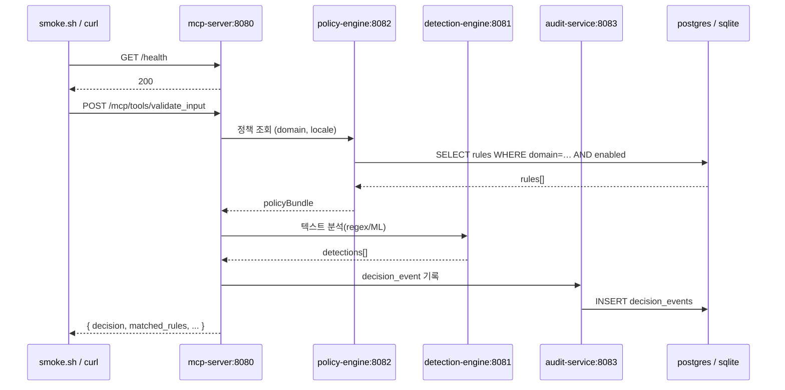

# 코드 단위 리뷰 보고서 / Line-by-Line Code Review

> 분석일 / Analysis Date: 2026-05-20
> 대상 / Target: `/Users/wise/Developer/Web(Node,Script)/MCP-type-Guardrails-Service` (현재 작업 디렉토리)
> 리뷰 레벨 / Review Level: **2** — 약 3년 경력 주니어 개발자 / Junior developer (~3y)
> 선택 파일 수 / Files Reviewed: **13 / 13** (데이터 JSON 4종은 부록 처리)
> 분석 / Analyst: Claude (Anthropic)

---

## 1. 작업공간 인벤토리 / Workspace Inventory

### 1.1 디렉토리 트리 (depth 4, `.git` / `.review` / `test/runs` 제외)

```
MCP-type-Guardrails-Service/
├── .doc/                              # PRD 및 조사 자료(리뷰 대상 외)
├── .env.example                       # 환경변수 템플릿
├── .gitignore
├── .omc/                              # oh-my-claudecode 메타(리뷰 대상 외)
├── Makefile                           # docker compose 매트릭스 자동화
├── README.md                          # 운영 문서(리뷰 대상 외)
├── docker-compose.yml                 # 핵심 스택(Postgres+Redis+4 services)
├── docker-compose.admin.yml           # Admin overlay
├── docker-compose.admin-local.yml     # Admin local mode override
├── docker-compose.admin-standalone.yml# Admin 독립 호스트 배포
├── docker-compose.admin-web.yml       # Admin Web(Next.js) overlay
├── docker-compose.food.yml            # Phase 2 (manufacturing-food)
├── docker-compose.local.yml           # SQLite 전용 경량 모드
├── docker-compose.privacy.yml         # Phase 1 (privacy)
├── scripts/
│   ├── gen-rules.py                   # 정책 룰 generator
│   ├── init-db.sql                    # Postgres 초기 스키마
│   ├── smoke.sh                       # MCP HTTP 스모크
│   ├── manufacturing-food.{kr,en}.json# gen-rules.py 산출물 (데이터)
│   └── privacy.{kr,en}.json           # gen-rules.py 산출물 (데이터)
└── test/
    ├── Guardrails-Service-Phase#1.sh           # 13-step build/deploy/test driver
    ├── Guardrails-Service-Phase#1-results.md
    └── runs/<TS>/                              # 회차별 raw log (리뷰 대상 외)
```

### 1.2 파일 분포 / File Distribution

| 분류 | 개수 | 비고 |
|---|---|---|
| Makefile | 1 | 273 LOC |
| Python | 1 | `scripts/gen-rules.py` 4539 LOC |
| Shell | 2 | `scripts/smoke.sh` 38 LOC, `test/Guardrails-Service-Phase#1.sh` (리뷰 범위 외) |
| SQL | 1 | `scripts/init-db.sql` 172 LOC |
| Docker Compose YAML | 8 | 총 ~553 LOC |
| 환경 템플릿 | 1 | `.env.example` 38 LOC |
| 데이터 JSON (산출물) | 4 | 21,604 LOC, 약 620KB — Step 8 부록 |
| 문서 / 리소스 | 다수 | `.doc/`, README, 테스트 로그 — 코드 리뷰 범위 외 |

### 1.3 빌드 / 의존 매니페스트 / Build & Dependency Manifests

| 항목 | 확인 결과 |
|---|---|
| `package.json` / `requirements.txt` / `go.mod` 등 언어별 매니페스트 | **확인 불가 — 파일 부재.** 본 리포지토리는 *오케스트레이션 루트*이며, 실 서비스 코드와 매니페스트는 형제 디렉토리(`../Guardrails-Service-*`)에 분리되어 있음. |
| Lockfile | 동일 — 본 루트에는 없음. |
| 빌드 진입점 | `Makefile` (`docker compose build`로 위임), `docker-compose.*.yml`의 `build.context` (형제 디렉토리) |
| 의존 런타임 | Docker, Docker Compose, `bash`, `python3` (스크립트 실행 시), `jq`/`curl` (smoke), Make |

### 1.4 진입점 후보 / Entry-point Candidates (이 저장소 내)

| 진입점 | 경로 | 호출 방식 |
|---|---|---|
| `make` 타깃 | `Makefile` | `make up-p1`, `make smoke`, `make help`, … |
| `scripts/gen-rules.py main()` | `scripts/gen-rules.py:4501` | `python3 scripts/gen-rules.py` |
| `scripts/smoke.sh` | `scripts/smoke.sh` | `bash ./scripts/smoke.sh` (또는 `make smoke`) |
| `scripts/init-db.sql` | `scripts/init-db.sql` | Postgres 컨테이너 entrypoint(`docker-entrypoint-initdb.d/01-init.sql`) 가 첫 부팅 시 실행 |
| Phase test driver | `test/Guardrails-Service-Phase#1.sh` | 운영자 수동 실행 (본 리뷰 범위 외) |

### 1.5 테스트 / Test

- 본 루트 디렉토리에는 **단위 테스트가 존재하지 않음**. `test/` 폴더는 *통합/E2E 시나리오 드라이버*와 그 로그 보관소.
- 컴포넌트별 테스트는 형제 디렉토리(`npm test`, `pytest`)에서 수행. `Makefile:test` 타깃이 그 경로를 안내.

---

## 2. 프로젝트 구조 / Project Structure

### 2.1 소스 트리 (역할 주석) / Source Tree with Role Notes

```
.
├── Makefile                              # phases × suffixes 매트릭스 → up-/down- 타깃 자동 생성
├── .env.example                          # 모든 서비스가 공유하는 env 템플릿
├── docker-compose.yml                    # base: postgres, redis, mcp-server, policy-engine,
│                                         #       detection-engine, audit-service
├── docker-compose.privacy.yml            # P1 overlay: GUARDRAILS_ENABLED_DOMAINS=global +
│                                         #             scripts/privacy.{kr,en}.json mount
├── docker-compose.food.yml               # P2 overlay: …,manufacturing-food + mf-food JSON mount
├── docker-compose.local.yml              # 경량 모드: postgres/redis 비활성, SQLite 단일 파일
├── docker-compose.admin.yml              # admin-service 추가 (postgres+policy-engine depends)
├── docker-compose.admin-local.yml        # admin-service에 sqlite 모드 강제 + depends_on !reset
├── docker-compose.admin-standalone.yml   # 독립 stack (자체 admin-postgres + 자체 network)
├── docker-compose.admin-web.yml          # admin-web (Next.js) 추가 — 브라우저↔host 포트 통신
└── scripts/
    ├── gen-rules.py                      # 룰 데이터 → 4 JSON 번들 출력
    ├── init-db.sql                       # Postgres 초기 스키마(11 tables + 6 indexes)
    ├── smoke.sh                          # MCP API 스모크 4-step (health + 3 validate*)
    ├── privacy.{kr,en}.json              # gen-rules.py 산출물 (Phase 1)
    └── manufacturing-food.{kr,en}.json   # gen-rules.py 산출물 (Phase 2)
```

### 2.2 모듈·패키지 의존 그래프 / Module & Package Dependency Graph

본 저장소는 *오케스트레이션* 루트이므로 의존 그래프는 **compose overlay 합성 순서**와 **컨테이너 간 네트워크 의존**으로 표현된다.

#### Compose overlay 합성 (Makefile 정의)



- `base + p1` = Phase 1
- `base + p1 + p2` = Phase 1 + 2
- `… + admin.yml + local.yml + admin-local.yml` 순서가 **반드시** 유지되어야 `depends_on: !reset []` 가 admin의 postgres 의존을 끊는다 (Makefile 라인 18–19 주석 참조).

#### 컨테이너 의존 (런타임)



### 2.3 호출·응답 흐름도 / Call & Response Flow

`scripts/smoke.sh`가 노출하는 외부 시점의 호출 흐름:



호출 체인은 **본 저장소 외부**(형제 서비스 코드)에서 실제 구현되며, 본 리뷰는 그 인터페이스가 compose env(`POLICY_ENGINE_URL`, `DETECTION_ENGINE_URL`, `AUDIT_SERVICE_URL`)로 어떻게 연결되는지까지만 다룬다.

### 2.4 외부 패키지 인벤토리 / Third-Party Package Inventory

본 루트에는 언어별 매니페스트가 없으므로, **컨테이너 이미지 및 시스템 도구** 의존을 표로 정리한다.

| 패키지 / Image | 버전 / Version | 사용처 / Used In | 역할 / Purpose | 라이선스 |
|---|---|---|---|---|
| `postgres:16-alpine` | 16-alpine | `docker-compose.yml:33`, `docker-compose.admin-standalone.yml:24` | RDBMS — rules / decision_events / admin_users 등 | PostgreSQL License |
| `redis:7-alpine` | 7-alpine | `docker-compose.yml:53` | 캐시·세션 | BSD-3 |
| Docker Compose | (호스트 설치) | `Makefile` 전체, 모든 yml | 컨테이너 오케스트레이션 | Apache-2.0 |
| `bash` | 호스트 | `scripts/smoke.sh`, `Makefile` | 쉘 | GPL-3 |
| `jq` | 호스트 | `scripts/smoke.sh`, `Makefile:248`,`254` | JSON pretty | MIT |
| `curl` | 호스트 | `scripts/smoke.sh`, `Makefile:248`,`251`,`254` | HTTP 클라이언트 | MIT |
| `python3` ≥ 3.10 | 호스트 | `scripts/gen-rules.py` (`from __future__ import annotations`, `dict | None`) | 룰 생성 | PSF |
| `pgcrypto` Postgres extension | - | `init-db.sql:4` | `gen_random_uuid()` | PostgreSQL License |
| `wget` (alpine) | 컨테이너 내부 | `docker-compose.admin-web.yml:33` | admin-web healthcheck | GPL |

> Python stdlib 외에는 외부 의존 없음 (`json`, `sys`, `dataclasses`, `datetime`, `pathlib`, `typing` 만 사용).

### 2.5 데이터 흐름·상태 저장소 / Data Flow & State Stores

- **Postgres 영속 볼륨**: `pg-data` (compose 기본), `admin-pg-data` (standalone)
- **Redis 영속 볼륨**: `redis-data` (appendonly 모드, `docker-compose.yml:56`)
- **Policy 캐시 볼륨**: `policy-cache` (`/app/.cache`)
- **SQLite 단일 파일 볼륨**:
  - `gr-sqlite` — Policy Engine + Admin 공유 (`/app/var/guardrails.db`)
  - `audit-sqlite` — Audit Service 전용 (`/app/var/audit.db`)
  - `admin-data` — Admin 일반 데이터 (`/app/var`)
- **읽기 전용 마운트**:
  - `./scripts/init-db.sql → /docker-entrypoint-initdb.d/01-init.sql`
  - `./scripts/privacy.{kr,en}.json → /app/policies/global/…`
  - `./scripts/manufacturing-food.{kr,en}.json → /app/policies/manufacturing-food/…`
  - `./scripts → /app/seeds:ro` (policy-engine)
- **포트 노출 (env 기본값)**:
  - 8080 mcp · 8081 detection · 8082 policy · 8083 audit · 8084 admin · 3001 admin-web · 5432 postgres · 6379 redis · 5433 admin-postgres (standalone)
- **Config 소스**: `.env`(파일에 의해 `.env.example` 복사), compose `environment:` 블록의 `${VAR:-default}` 패턴
- **I/O 경계**:
  - `gen-rules.py` → `scripts/*.json` write
  - `smoke.sh` → HTTP 호출, 결과 stdout
  - 모든 컨테이너 → host port mapping을 통해 외부 노출
  - admin-web → 브라우저(외부) → admin-service host port

### 2.6 진입점 목록 / Entrypoints

| # | 진입점 | 위치 | 호출 방식 |
|---|---|---|---|
| 1 | `make up-p1[…]` / `down-…` | [Makefile](../../Makefile) (라인 46–61에서 자동 생성) | CLI |
| 2 | `make smoke` | [Makefile:244](../../Makefile#L244) | CLI → `bash ./scripts/smoke.sh` |
| 3 | `main()` | [scripts/gen-rules.py:4501](../../scripts/gen-rules.py#L4501) | `python3 scripts/gen-rules.py` |
| 4 | Postgres init | [scripts/init-db.sql](../../scripts/init-db.sql) | Docker entrypoint, 컨테이너 첫 부팅 |
| 5 | `scripts/smoke.sh` | [scripts/smoke.sh:1](../../scripts/smoke.sh#L1) | `bash ./scripts/smoke.sh` |

---

## 3. 리뷰 파일 선정 / File Selection

`--include`/`--exclude` 미지정 → 기본 룰 적용 (JSON 데이터 / 로그 / 문서 제외). `--max-files=40`, `--entry-only=false`.

### 3.1 선택 파일 / Selected Files

| # | 경로 / Path | LOC | 선택 사유 / Reason |
|---|---|---|---|
| 01 | [Makefile](Makefile.md) | 273 | 모든 운영 진입점이 여기서 시작 |
| 02 | [.env.example](.env.example.md) | 38 | 전 서비스 공통 env 계약 |
| 03 | [docker-compose.yml](docker-compose.yml.md) | 182 | base — 5개 서비스 + 2 infra 정의 |
| 04 | [docker-compose.privacy.yml](docker-compose.privacy.yml.md) | 26 | Phase 1 overlay |
| 05 | [docker-compose.food.yml](docker-compose.food.yml.md) | 28 | Phase 2 overlay |
| 06 | [docker-compose.local.yml](docker-compose.local.yml.md) | 53 | SQLite 경량 모드 |
| 07 | [docker-compose.admin.yml](docker-compose.admin.yml.md) | 59 | Admin overlay |
| 08 | [docker-compose.admin-local.yml](docker-compose.admin-local.yml.md) | 27 | Admin × Local 결합 override |
| 09 | [docker-compose.admin-standalone.yml](docker-compose.admin-standalone.yml.md) | 96 | 독립 stack |
| 10 | [docker-compose.admin-web.yml](docker-compose.admin-web.yml.md) | 42 | Admin Web overlay |
| 11 | [scripts/gen-rules.py](scripts/gen-rules.py.md) | 4539 | 룰 생성기 — 임계치 초과, **블록 단위** 분석 |
| 12 | [scripts/init-db.sql](scripts/init-db.sql.md) | 172 | Postgres 초기 스키마 |
| 13 | [scripts/smoke.sh](scripts/smoke.sh.md) | 38 | MCP 스모크 |

### 3.2 미선택 파일 (Step 8 부록 A) / Deferred Files

| # | 경로 | LOC | 제외 사유 |
|---|---|---|---|
| D1 | `scripts/privacy.kr.json` | 7146 | `gen-rules.py` 산출 데이터 — 생성기 리뷰로 대체 |
| D2 | `scripts/privacy.en.json` | 7146 | 동상 |
| D3 | `scripts/manufacturing-food.kr.json` | 3656 | 동상 |
| D4 | `scripts/manufacturing-food.en.json` | 3656 | 동상 |
| D5 | `README.md` | 1064 (36KB) | 문서 — 기본 exclude `*.md` |
| D6 | `.doc/PRD.md`, `.doc/Perplexity-*.md` | - | 문서 — 기본 exclude `*.md` |
| D7 | `test/Guardrails-Service-Phase#1.sh` | - | 통합 테스트 드라이버, 본 루트 범위 외(`test/`는 로그 디렉토리 비중이 절대적) |
| D8 | `test/runs/**` | - | 회차별 raw 로그 |
| D9 | `.gitignore` | - | 빌드 부산물 차단 목적의 메타 |
| D10 | `.omc/**` | - | 도구 메타 |

---

## 4. 종합 분석 / Synthesis

### 4.1 반복 패턴 / Recurring Patterns

- **`${VAR:-default}` 환경변수 패턴**이 모든 compose 파일에 일관 적용 → `.env` 부재 시에도 동작.
- **healthcheck 패턴**: `node -e "require('http').get(...)"` 한 줄로 모든 Node 서비스가 동일 형식 사용 → 일관성 좋음, 그러나 `node` 바이너리가 이미지 내 존재해야 함(빌드 측 책임).
- **`!reset []` 오버라이드 패턴**: `docker-compose.local.yml` 과 `admin-local.yml` 에서 `depends_on: !reset []` 사용 → overlay 합성 순서 의존성을 만든다 (Makefile 라인 18–19 주석에 명시되어 있는 *implicit contract*).
- **`block_or_*` 액션의 비표준 표현**: `gen-rules.py`의 룰 데이터 튜플에는 `block_or_summarize`, `block_or_route`, `add_compliance_notice` 등 enum 외 값이 다수 존재. `emit_rules`의 `non_std_map` 가 후처리로 매핑.

### 4.2 계층 위반 / Layering Violations

- `docker-compose.yml`의 `build.context`가 **상대 경로로 형제 디렉토리**를 가리킴 (`../Guardrails-Service-Server` 등). 이는 단일 워크스페이스(여러 형제 폴더가 같은 부모 디렉토리에 있다는 가정)를 강제한다. 환경 분리·CI clone 시 깨질 수 있음. *layering 위반은 아니나 결합도 위험.*
- `docker-compose.yml`의 `detection-engine.build.context` 가 `../../DA(Python,R,...)/...` 으로 **두 단계 위 디렉토리**까지 거슬러 올라간다. 디렉토리 이름에 괄호와 쉼표(`(Python,R,...)`)가 포함되어 있어 일부 셸·CI 도구에서 escape 필요. → Risk Hotspot #2.

### 4.3 위험 핫스팟 / Risk Hotspots

1. **`gen-rules.py:4283–4302` `non_std_map`** — 룰 작성 시 enum 외 액션 문자열을 자유롭게 쓰는 관행이 굳어짐. 데이터에 오타가 있으면 *경고 없이* 원본 그대로 emit되어 schema 검증을 깨뜨릴 위험.
2. **상대 빌드 경로 `../../DA(Python,R,...)/Guardrails-Service-Detection-Engine`** — 디렉토리 이름의 특수문자, 워크스페이스 가정.
3. **`init-db.sql:49` `ALTER TABLE rules ADD COLUMN IF NOT EXISTS source ...`** — `CREATE TABLE` 직후 같은 컬럼을 다시 `ALTER ADD IF NOT EXISTS`. 신규 환경에서는 무해하지만 idempotent 마이그레이션을 인-place로 적는 패턴은 향후 더 큰 변경이 들어오면 충돌 가능.
4. **`.env.example` 의 비밀 default**: `change-me-in-prod`, `dev-key-please-change`. 운영자가 *덮어쓰지 않으면* 그대로 컨테이너에 주입된다 (compose의 `${VAR:-default}` 가 fail-fast 아님).
5. **`smoke.sh:4` API_KEY default = `dev-key-please-change`** — 같은 값이 클라이언트와 서버 양쪽 fallback이라 로컬에서는 동작하지만, *운영 stack 에 대고 실수로 실행해도 인증 통과* 가능.

### 4.4 삭제 후보 / Deletion Candidates

- `gen-rules.py:278` 주석 `# action enum doesn't include "advise_pseudonymization" — switch to warn at emit time` — 이미 `non_std_map` 으로 처리되므로 *현 시점에는* TODO가 아닌 *역사*. 코드를 읽는 사람에게는 혼란.
- `gen-rules.py:4292,4297` `block_or_pseudonymize` 가 `non_std_map`의 키와 값이 같음(자기 자신으로 매핑) — 동일하게 `block_or_pseudonymize`로 들어오는 경우가 enum에 이미 있으므로 라인 자체가 redundant. 코드 의도(“allow-list 화”)를 명시하려면 주석 한 줄.
- `Makefile:35` `PHASES := p1 p1-p2` — 향후 `p3` 추가 시 같은 라인 한 군데만 변경하면 되도록 설계되어 있으나, 현 시점에서 `p1-p2`가 *문자열*이라는 것이 매크로 안에서 트리키함 (`-` 이 substitution friendly).

### 4.5 테스트 공백 / Test Gaps

- `scripts/gen-rules.py` 의 단위 테스트가 *본 저장소에는 없음*. 정규식 컴파일 실패·매핑 누락은 *런타임 실행 후* 만 발견됨.
- `Makefile`의 `up-/down-` 매트릭스가 `eval` + `foreach` 로 자동 생성 → `make -n up-p1-admin-web-local` 같은 dry-run으로만 검증 가능. 명시적 CI 가 없는 듯.
- `init-db.sql` 의 idempotency는 `IF NOT EXISTS`에 의존 — Postgres 16 가정. 다운그레이드/포팅 검증 부재.

### 4.6 다음 단계 / Next Steps

1. `gen-rules.py`에 `assert action_mapped in ACTIONS` 한 줄 추가 — 비표준 액션이 매핑 누락된 경우 *즉시* 실패.
2. `non_std_map` 을 dict가 아닌 명시적 enum + 대응표로 분리하고, 데이터 정의 측에서 표준 액션만 쓰도록 정리 (PR 가능 범위).
3. compose `build.context` 의 상대 경로 의존을 **workspace root** 환경변수(`GUARDRAILS_WORKSPACE_ROOT`)로 추상화 → CI / 사용자 별 배치 자유도 확보.
4. `init-db.sql:48–49` 의 `CREATE TABLE` + 직후 `ALTER TABLE ADD COLUMN IF NOT EXISTS` 콤보는 **마이그레이션 도구**(예: `node-pg-migrate`, `flyway`)로 옮기는 것이 향후 안전.
5. `smoke.sh`에 응답 status·필드 단위 어서션 추가(`jq -e '.matched_rules | length > 0'` 등). 현재는 `curl -fsS` HTTP 비-2xx만 잡는다.
6. 환경 비밀 default 값(예: `dev-key-please-change`)이 운영 모드(`NODE_ENV=production`)에서 들어왔을 때 컨테이너 부팅 시 **명시적 거부**(서비스 측 코드)로 fail-fast.

---

## 5. 부록 / Appendices

### A. 미선택 파일 목록 / Deferred Files

Step 3.2 표 참조.

### B. 외부 패키지 전체 목록 / Full Package Inventory

Step 2.4 표 참조. 본 저장소에는 *언어 패키지 매니페스트가 없음*. 실제 NPM/PyPI 의존은 형제 서비스 디렉토리(`../Guardrails-Service-*`, `../../DA(...)/...`)의 `package.json` / `requirements.txt` 에서 관리.

### C. 용어 사전 / Glossary (Level 2에서는 선택 — 본 보고서에서는 생략)

본 리뷰는 Level 2 기준이므로 용어 사전은 생략. 약어가 등장한 곳에서 인라인 설명함.

---

## 디렉토리별 요약 / Per-Directory Abstracts

- [루트 디렉토리 요약 / Root Directory Abstract](root_Abstract.md)
- [scripts/ 디렉토리 요약](scripts/scripts_Abstract.md)
